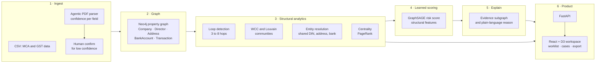

<div align="center">



<br>


### Graph-AI platform that exposes shell-company networks, circular trading and fraudulent GST input-tax-credit claims, with evidence an auditor can defend.

<br>

[](https://github.com/phadtareshivansh/DhanChakra/actions/workflows/ci.yml)


[**Quick start**](#-quick-start) ·
[**How it works**](#-how-it-works) ·
[**Features**](#-features) ·
[**Measured results**](#-measured-results) ·
[**Docs**](#-documentation) ·
[**Security**](#-security-and-privacy)

</div>

---

## Why DhanChakra

GST fraud rarely shows up in a single invoice. A fraud ring registers many look-alike companies, passes fabricated invoices around a loop (A → B → C → A), and each firm claims input tax credit against tax that was never genuinely paid. Every individual invoice looks legitimate. **The fraud is the shape of the network.**

Row-by-row tools struggle here because a loop of unknown length needs an unknown number of joins, and rings deliberately cross state boundaries. DhanChakra models companies, directors, addresses, bank accounts and invoices as a **graph**, so a ring becomes one connected, inspectable object.

The scale is real. Indian press reported fake-ITC detections of **₹74,782 crore in FY26** ([Business Standard](https://www.business-standard.com/economy/news/gst-itc-fraud-detections-jump-to-74-782-cr-in-fy26-cases-more-than-double-126072801395_1.html)), and government systems such as GSTN's ADVAIT and BIFA already apply analytics to the problem. DhanChakra is not trying to replace them. It focuses on what investigators keep asking for: **why was this flagged, and can I show the evidence?**

> **Design principle:** DhanChakra prioritizes cases for human review. It never decides guilt. Every score ships with the loop, shared director or burst of transactions that produced it.

---

## ✨ Features

<table>
<tr>
<td width="50%" valign="top">

### 🔍 Detect
- **Circular-trading detection** for 3 to 8 hop invoice loops
- **Community detection** (WCC, Louvain) to surface tight shell-company clusters
- **Entity resolution** that links identities sharing a DIN, address or bank account, using exact and fuzzy matching
- **GraphSAGE risk scoring** on structural features, trained on weak labels
- **e-Way Bill mismatch signal** for high-value invoices without movement records
- **Burst detection** for sudden high-volume flows between the same entities

</td>
<td width="50%" valign="top">

### 🧾 Explain and act
- **Evidence for every flag**: the specific subgraph and a plain-language reason
- **Interactive network workspace** (D3) with timeline, path finder and expand-on-demand
- **Case management** with assignment, comments, activity timeline and export bundles
- **Analyst feedback loop** to confirm fraud or mark false positives
- **Watchlist and notifications** for score and structure changes
- **AI-drafted case summaries**, clearly labelled for officer review

</td>
</tr>
<tr>
<td width="50%" valign="top">

### 📥 Ingest
- CSV loaders for company and transaction data
- **Agentic PDF extraction** of directors, DIN, address and shareholding, with per-field confidence and review before commit
- Idempotent loaders and job tracking

</td>
<td width="50%" valign="top">

### 🛡️ Operate safely
- Role-based access with organization scoping
- Login rate limiting, lockout, refresh tokens and logout revocation
- Audit log of sensitive actions
- Startup gate that refuses weak secrets in production
- Hashed or synthetic identifiers only, no raw PAN or Aadhaar

</td>
</tr>
</table>

---

## 🧠 How it works



1. **Data becomes a graph.** Companies, directors, addresses, bank accounts and invoices become nodes. Relationships such as *director of*, *invoiced* and *registered at* become edges.
2. **Deterministic algorithms run first.** Cycle detection, community detection and centrality need no training data, and an auditor can point at the result on screen.
3. **Entity resolution removes disguises.** Shell identities that share a DIN, address or bank account are linked before scoring.
4. **A GraphSAGE model adds a learned risk score** on top of the structural signals.
5. **Every flag carries its evidence.** The explain endpoint returns the supporting subgraph and a readable reason, not just a number.

---

## 📊 Measured results

> Numbers below are copied from files generated by the repo's own scripts. Nothing is estimated. Read the caveats before quoting any of it.

### Model benchmark (self-generated synthetic graphs)

Fixed seeded splits by graph, 5 seeds, mean values, edge-derived features with no cycle feature (the fair comparison). Full tables, ablation and false-positive stress test: [`docs/benchmarks.md`](docs/benchmarks.md).

| Model | Precision@50 | Recall@50 | AUC-PR |
|---|---|---|---|
| Rule-only baseline | 0.468 | 0.348 | 0.497 |
| Logistic regression | 0.992 | 0.738 | 0.985 |
| Gradient boosting | 1.000 | 0.744 | 0.994 |
| **GraphSAGE** | 0.988 | 0.735 | 0.992 |

**What this says, honestly**
- Structural, graph-derived features are what matter. Any model using them beats the rule-only baseline by a wide margin.
- **GraphSAGE is essentially tied with gradient boosting** on these graphs. We report that rather than hide it, and we keep the explainable structural layer as the backbone. GraphSAGE is expected to help more on larger, noisier graphs, which is still to be shown.
- These graphs are **self-written generators**, so they validate the pipeline, not real-world detection rates.
- **The real IBM AMLworld table has not been run yet.** It is shown as empty on purpose. Run it yourself with `make benchmark-amlworld`.

### Performance

Measured on the machine that generated [`docs/performance.md`](docs/performance.md):

| Fix found by the scale test | Before | After |
|---|---|---|
| Bulk load of 10,000 companies (applying graph indexes) | 281.9 s | 2.4 s |

That is roughly a **117× speed-up** from applying indexes the stack had defined but never applied. Betweenness centrality (O(V·E)) did not finish within 300 s at 100K nodes, so the main analytics path uses PageRank. Details are in [`docs/performance_findings.md`](docs/performance_findings.md).

---

## 🚀 Quick start

**Prerequisites:** Docker with Compose, `make`, and about 4 GB of free memory.

```bash
git clone https://github.com/phadtareshivansh/DhanChakra.git
cd DhanChakra

make env        # writes .env with strong random secrets and the seeded login slots
make up         # builds and starts Neo4j, PostgreSQL, API and frontend
make bootstrap  # loads the sample dataset and runs analytics (idempotent)
make smoke      # health-checks the API and frontend
```

Open **http://localhost:5173** and sign in with the Super Admin credentials from your generated `.env` (`SUPER_ADMIN_EMAIL`, `SUPER_ADMIN_PASSWORD`).

| Service | URL |
|---|---|
| Web app | http://localhost:5173 |
| API and OpenAPI docs | http://localhost:8000/docs |
| Neo4j Browser | http://localhost:7474 (bolt://localhost:7687) |
| PostgreSQL | localhost:5432 |

<details>
<summary><b>All make targets</b></summary>

| Target | What it does |
|---|---|
| `make env` | Create `.env` from `.env.example` with fresh secrets |
| `make up` / `make down` | Start or stop the stack (volumes kept) |
| `make restart` | Restart the API after Python edits |
| `make ps` / `make logs` | Service status and logs |
| `make bootstrap` | Load sample data and run analytics |
| `make migrate` | Apply pending Postgres migrations |
| `make apply-schema` | Apply Neo4j constraints and indexes |
| `make test` / `make test-all` | Run the API test suite (the second seeds data first) |
| `make benchmark` | Run the model benchmark and refresh `docs/benchmarks.md` |
| `make benchmark-amlsim` / `make benchmark-amlworld` | Benchmark on AMLSim-style or real IBM AMLworld data |
| `make scale-test` | Run the scale test and refresh `docs/performance.md` |
| `make reset` | **Destructive.** Stop the stack and delete all data volumes |

</details>

---

## 🧱 Tech stack

| Layer | Technology | Why |
|---|---|---|
| Graph store and algorithms | Neo4j 5.23 with Graph Data Science | Native multi-hop traversal; WCC, Louvain and PageRank built in |
| API | FastAPI, Pydantic v2 | Async, validated, self-documenting |
| App data | PostgreSQL 16 | Users, cases, audit log, jobs, model versions |
| ML | PyTorch (CPU), custom sparse GraphSAGE, NumPy checkpoint for light deployments | Avoids fragile PyG wheels; runs anywhere |
| Frontend | React 18, TypeScript, Vite, Tailwind, D3 | Interactive force-directed investigation workspace |
| Quality | pytest (200+ tests), ESLint, Playwright visual tests, i18n checks, GitHub Actions CI | |
| Packaging | Docker Compose, Render blueprint | One-command local stack |

---

## 🗂️ Repository layout

```text
DhanChakra/
├── api/             FastAPI app, services, routes, migrations, tests, benchmarks
├── graph/           Neo4j constraints, indexes, analytics and seed Cypher
├── analytics/       Structural analytics and ML experiments
├── ingestion/       CSV loaders and sample data
├── frontend/        React + TypeScript web app and design system
├── shared/          Shared contracts and utilities
├── scripts/         Environment init and bootstrap helpers
├── docs/            Product, technical, design, benchmark and performance docs
└── docker-compose.yml, Makefile, render.yaml
```

---

## 🛡️ Security and privacy

- **No open sign-up.** Accounts are created by administrators.
- **Production startup gate.** The API refuses to boot with placeholder secrets or localhost CORS when `APP_ENV=production`.
- **Auth hardening.** Rate limiting per IP and per account, lockout, short-lived access tokens, refresh tokens and logout revocation.
- **Audit trail.** Sensitive actions are logged with who, what and when.
- **Privacy by design.** The sample data uses hashed or synthetic identifiers. Do not load real PAN, Aadhaar or raw bank account numbers.
- **Not yet claimed:** SOC 2, ISO 27001 or any compliance certification. See the roadmap below for what is planned.

Found a vulnerability? Please report it privately to the maintainers instead of opening a public issue.

---

## 🧭 Roadmap

| Area | Status |
|---|---|
| Structural analytics, entity resolution, GraphSAGE scoring, explain, cases, ingestion | ✅ Built |
| Benchmarks, scale test, e-Way Bill signal, temporal view, feedback loop, watchlist | ✅ Built, with caveats in `docs/` |
| Organizations and tenant isolation | 🚧 In progress |
| SSO and MFA, API keys, tamper-evident audit log | 📋 Planned |
| Connector framework, async job queue, incremental rescoring | 📋 Planned |
| Model registry, drift monitoring, review workflows | 📋 Planned |
| Public API with webhooks, scheduled reports | 📋 Planned |
| Real-data validation on IBM AMLworld and on customer data | 📋 Planned, needs data access |

The full plan lives in [`docs/OPENCODE_PRODUCT_TASKS.md`](docs/OPENCODE_PRODUCT_TASKS.md).

---

## 📚 Documentation

| Document | Contents |
|---|---|
| [`docs/01_PRD.md`](docs/01_PRD.md) | Product requirements, personas, user stories |
| [`docs/02_TRD.md`](docs/02_TRD.md) | Architecture, algorithms, API spec |
| [`docs/03_UIUX_Design.md`](docs/03_UIUX_Design.md) | Design system, colors, typography, components |
| [`docs/04_AppFlow.md`](docs/04_AppFlow.md) | Navigation and user journeys |
| [`docs/05_Backend_Schema.md`](docs/05_Backend_Schema.md) | Graph and relational schema |
| [`docs/benchmarks.md`](docs/benchmarks.md) | Model benchmark, ablation, false-positive test |
| [`docs/performance.md`](docs/performance.md) | Scale test results |
| [`docs/OPERATIONS.md`](docs/OPERATIONS.md) | Roles, logins, Super Admin recovery, API surface, deployment notes |
| [`docs/Demo_Script.md`](docs/Demo_Script.md) | Timed product walkthrough |

---

## 🔬 Research and industry references

DhanChakra builds on public work. Ideas, datasets and tools are credited here; mention does not imply endorsement by or affiliation with any organization.

| Source | How it informs the project |
|---|---|
| **IBM Research and ETH Zurich**, *Realistic Synthetic Financial Transactions for Anti-Money Laundering Models* (AMLworld, [arXiv:2306.16424](https://arxiv.org/abs/2306.16424)) | Benchmark dataset and laundering typologies (cycles, fan-in, fan-out, scatter-gather) |
| **IBM AMLSim** ([github.com/IBM/AMLSim](https://github.com/IBM/AMLSim)) | Format reference for our AMLSim-style synthetic generator |
| **Neo4j Graph Data Science** | WCC, Louvain and PageRank; fraud-ring and community-detection patterns |
| **Hamilton, Ying, Leskovec**, *Inductive Representation Learning on Large Graphs* (GraphSAGE, 2017) | Inductive GNN used for scoring new entities |
| **Amazon Web Services**, *Detect financial transaction fraud using a Graph Neural Network with Amazon SageMaker* | Reference architecture for GNN transaction-fraud detection |
| **Weber et al.**, Elliptic Bitcoin dataset | Prior work on graph learning for illicit-transaction detection |
| **GSTN, CBIC, DGGI** public reporting on ADVAIT, BIFA and ITC-fraud enforcement | Problem framing and scale |
| **Ministry of Corporate Affairs**, Company Master Data (data.gov.in) | Public company-registry schema |

---

## 🧪 Testing

```bash
make test-all                      # seeds sample data, then runs the full API suite
cd frontend && npm run lint        # ESLint, zero warnings allowed
cd frontend && npm run i18n:check  # no hard-coded UI strings
cd frontend && npm run test:visual # Playwright visual regression
```

CI runs the Docker build, health checks, bootstrap, API tests and the frontend type-check and build on every push.

---

## ⚖️ Responsible use

DhanChakra surfaces **risk for human review**, not verdicts. A legitimate, tightly integrated supply chain can look structurally similar to a shell ring, so every flag is paired with evidence and should be reviewed by a trained officer. Results on synthetic data do not predict real-world precision. Validate on your own data before relying on any score.

---

## 🤝 Contributing

1. Branch from `main` using `type/short-description` (for example `feat/timeline-filters`).
2. Run `make test-all` and the frontend checks before opening a pull request.
3. Add a migration for any schema change instead of editing an applied one.
4. Never commit secrets, datasets or large model files.

---

## 📄 License

No open-source license has been granted. Unless a `LICENSE` file states otherwise, all rights are reserved by the authors.

---

<div align="center">


**DhanChakra** · See the whole network. Prove the pattern.

</div>