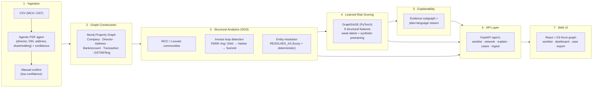

# Dhan-Chakra — Architecture Slide

One slide for a product/architecture overview (reuse of TRD §1 pipeline, annotated with what each layer produced in this
build). Renders as Mermaid in GitHub/VS Code/Marp; an SVG export of the same diagram can be produced
for the deck.

## Pipeline (Mermaid)

## Annotated build facts (for the talk track)

| Layer | What is real in this build |
|---|---|
| Ingestion | CSV loader (MCA/GST), agentic PDF extraction with per-field confidence, review-before-commit |
| Graph | Neo4j 5 + GDS, schema per `05_Backend_Schema.md` §2 |
| Structural | GDS WCC/Louvain, Cypher variable-length cycles → 1 ring ₹500K; entity resolution (Jaro–Winkler + exact DIN/address/bank) |
| Risk scoring | GraphSAGE, checkpoint `gnn_risk_v1`, benchmark F1 0.51 / AUC-PR 1.0 / recall@k 1.0; live F1 0.67 |
| Explainability | Evidence subgraph + natural-language flag reason per entity |
| API/UI | 15 frontend modules, 40 API tests green, case export bundles evidence + subgraph |

## Diagram variants
- **Dark slide:** swap flowchart node fills for the app's design tokens (`--accent`/`--surface`).
- **Print (light):** `Demo_Script.md` Journey C shows the print-ready export already.